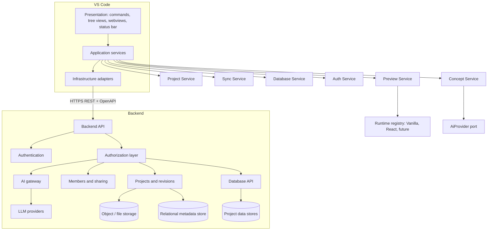

# Sandbox for VS Code: Architecture and Migration Assessment

*Prepared 21 October 2026. Phase 0 deliverable. No implementation code is proposed here; this document is meant to be split into Codex CLI implementation prompts.*

## 1. Executive Summary

**Recommended direction.** Make every sandbox project an ordinary folder that VS Code edits natively. A TypeScript extension adds only what VS Code does not provide: sign-in, project discovery and sharing, synchronization with the remote, a secure preview, AI concept generation and a database explorer. The backend stays the single authority for identity, authorization, storage, AI access and data.

**Major decisions**

1. **Projects are folders, not virtual documents.** The Design and Script tabs stop being concepts and become normal files under `src/`. What the project is (runtime, CSS framework) lives in `.sandbox/project.json`.
2. **Runtime abstraction from day one.** `ProjectRuntime` and `CssFramework` interfaces are introduced in the first runtime phase. Vanilla JS + Bootstrap is merely the first implementation, so React and Tailwind are added later by adding modules, not by changing the core.
3. **Preview = extension-owned loopback server + Webview shell + sandboxed iframe.** The Webview is treated as untrusted. User code runs in an iframe with an opaque origin and a strict CSP, with no bridge to extension APIs except a narrow, validated message channel.
4. **Authentication = OAuth 2.0 Authorization Code + PKCE in the system browser,** surfaced as a custom VS Code `AuthenticationProvider` (so sessions appear in the Accounts menu), tokens in `SecretStorage`.
5. **Synchronization = explicit Pull / Push** with revision-based optimistic concurrency, a per-file hash manifest and a three-way merge through VS Code's native diff/merge editor. Git compatibility is a later option, not a v1 dependency.
6. **Concept = `.sandbox/concept.md` as source of truth,** generated by a command. `/design` is kept as a directive inside a prompt file for backward compatibility.
7. **Database = Explorer tree view + one reusable Webview grid,** all operations through a backend Database API. The extension never holds database credentials.
8. **Authorization is backend-only.** Hiding commands in VS Code is ergonomics, never security.
9. **AI access goes through a backend gateway** behind `ConceptService` and `AiProvider` interfaces in the extension.
10. **Contract first.** A shared OpenAPI contract and a small fake backend let the extension be built and tested before the real backend exists.

**Deviations from the proposed phase order**

- Preview comes before authentication, because it is entirely local and exercises the runtime abstraction.
- A contract + fake backend phase is inserted before authentication, so the auth and sync phases have something real to talk to.
- Concept is built first with a mock provider (local), then connected to the real AI gateway after authentication.
- Security hardening is a gate on every phase plus a final audit, not only a single late phase.
- Tailwind is not a separate late phase of equal weight: it is a `CssFramework` plugin and follows React only because it benefits from a bundler.

### Answers to the ten key questions

**A. Should VS Code replace the browser application completely?** No. Keep a thin web surface for account management, billing/admin, invitation acceptance links and an optional read-only web preview of shared projects (useful for people without VS Code). Editing moves to VS Code. The backend is shared by both.

**B. Should Design and Script remain conceptual tabs?** No. They become files (`src/index.html`, `src/styles.css`, `src/script.js`, later `App.tsx`). Optionally a Project Explorer view can group files by role (markup, styles, logic) using metadata, but the file system stays the truth.

**C. How should Concept be represented?** A Markdown file, plus commands and an optional lightweight sidebar entry. Markdown gives diffing, versioning, sync, search, preview and Copilot/other tooling for free. A custom editor or Webview adds cost without benefit. A Webview is only justified later for a guided wizard.

**D. How should Database be represented?** Tree view for structure (tables), Webview only for the grid/record editor, native `showInputBox`/`showWarningMessage` for confirmations, and `schema.json` as a normal file for schema-as-code.

**E. How should Preview work?** Local loopback HTTP server owned by the runtime, displayed in a Webview panel via a sandboxed iframe; 'open in external browser' as a secondary action. Details in section 10.

**F. How should projects be synchronized?** Manual Pull/Push with revision checks first. Automatic sync only for non-conflicting pulls later; real-time collaboration last. Detailed comparison in section 8.

**G. How should Viewer access work locally?** A Viewer who holds files on disk can always edit them locally; that cannot be prevented. What can be prevented is any **remote** change, because the backend rejects writes from Viewers. Local read-only flags are an advisory convenience. See sections 8 and 9.

**H. What replaces the IIFE guard?** The IIFE gives namespace isolation only. Real isolation is a sandboxed iframe (opaque origin), CSP, a separate preview origin and a validated postMessage bridge. See section 10.

**I. Extension vs server?** Extension: UI, local files, local preview, sync orchestration, diff/merge UX. Server: identity, authorization, persistence, revisions, sharing, AI calls, database access. Table in section 6.

**J. How is React/Tailwind added later?** Implement `ReactRuntime` and `TailwindCssFramework`, register them in a runtime registry keyed by `runtime` and `cssFramework` metadata values. No change to commands, views, sync or auth. See section 14.

## 2. Current Platform to VS Code Mapping

| Existing capability | Current implementation | Recommended VS Code implementation |
| --- | --- | --- |
| Preview | Browser tab rendering the app | Webview Panel hosting a sandboxed iframe pointed at an extension-managed loopback server; command, editor-title button and status-bar action; optional external browser |
| Concept | GPT-assisted tab with `/design` | `.sandbox/concept.md` (normal Markdown) + command `Sandbox: Generate Concept`; prompt in `.sandbox/concept.prompt.md`; `/design` kept as a directive; AI through backend gateway |
| Design | HTML/CSS editor tab | Ordinary files: `src/index.html`, `src/styles.css` (React later: `App.tsx`, `index.css`); native editor, IntelliSense, Emmet |
| Script | JS editor tab with IIFE guard | Ordinary file `src/script.js`; isolation moves to the preview (iframe sandbox + CSP), not to code wrappers |
| Database | Graphical CRUD tab | Explorer tree view (tables) + Webview grid/record editor; all calls via backend Database API; `database/schema.json` as a normal file |
| Authentication | Web login | Custom `AuthenticationProvider`, OAuth 2.0 + PKCE in system browser, `UriHandler` callback, tokens in `SecretStorage` |
| Projects | Remote account projects | Local folders linked to a remote project through `.sandbox/project.json`; sidebar tree of My Projects / Shared With Me; Pull/Push |
| Sharing | Owner/editor/viewer | Backend `project_members`; extension shows role badges and gates commands for usability; backend enforces; invitation management through command palette + QuickPick |
| Project metadata | Implicit in app | `.sandbox/project.json` (committed), local state in `ExtensionContext` storage, secrets in `SecretStorage` |
| Console / errors | Browser devtools | Console and error forwarding from preview into an Output Channel and Problems panel |

## 3. Proposed System Architecture



**Layering rule.** Presentation (VS Code API) depends on application services; services depend on ports (interfaces); adapters implement ports. Only the presentation and adapter layers import `vscode`. Services and runtimes are unit-testable in plain Node.

## 4. VS Code Extension Architecture

**Activation.** Lazy. Activation events: `onView:sandbox.projects`, `onCommand:sandbox.*`, `workspaceContains:.sandbox/project.json`, and `onUri` for the auth callback. `activate()` only builds a composition root (manual dependency injection), registers contributions and returns; no network calls at startup.

**Commands** (namespaced `sandbox.*`, thin handlers that call services): `signIn`, `signOut`, `project.create`, `project.open`, `project.pull`, `project.push`, `preview.start/stop/restart`, `concept.generate`, `database.refresh`, `share.manage`. Each handler checks local capability (role, trust state) for UX and then calls a service. Services never trust the UI.

**Tree views.** `sandbox.projects` (My Projects, Shared With Me with role badges), `sandbox.database` (tables for the active project), optional `sandbox.concept` (outline of concept sections) later. Tree providers use `TreeDataProvider` with `onDidChangeTreeData` and read only from service caches.

**Webviews.** Only two: the Database grid and the Preview shell. Both use a strict CSP with nonces, `localResourceRoots` restricted to `media/`, no inline scripts, and a typed message protocol validated on the extension side (schema validation per message type). No secrets and no tokens are ever sent into a Webview.

**Services.** `AuthService`, `ProjectService`, `SyncService`, `PreviewService`, `ConceptService`, `DatabaseService`, `PermissionService` (UI hints derived from role), `TelemetryService` (optional, off by default).

**Providers (VS Code contribution implementations).** `AuthenticationProvider`, `TreeDataProvider`s, `WebviewPanelSerializer`, `UriHandler`, optional `FileDecorationProvider` (marks locally modified / conflicted files), optional `TextDocumentContentProvider` for remote-revision diffs (`sandbox-remote:` scheme, read-only).

**Storage.**

| Data | Location |
| --- | --- |
| Project identity and runtime | `.sandbox/project.json` (committed/synced) |
| Last-synced revision, file hashes | `.sandbox/sync-state.json` (local-only, git-ignored) or `ExtensionContext.workspaceState` |
| Recent projects, UI state | `globalState` |
| Access and refresh tokens | `SecretStorage` only |
| Preview ports, logs | in memory / extension storage path |

**Workspace Trust.** Declare `capabilities.untrustedWorkspaces`: `limited`. In an untrusted workspace the extension never starts dev servers, never runs `npm install`, never executes project scripts; read-only features and pull remain. Install scripts and build steps require trust.

**Runtime abstraction.** Runtimes live in `runtimes/` behind `ProjectRuntime`; `PreviewService` asks a `RuntimeRegistry` for the implementation named in `project.json`. See section 14.

## 5. Project File Structure

```text
my-project/
├── .sandbox/
│   ├── project.json        # committed: identity + runtime selection
│   ├── concept.md          # committed: generated/edited concept
│   ├── concept.prompt.md   # committed: user prompt, may start with /design
│   └── sync-state.json     # local-only, git-ignored
├── src/
│   ├── index.html
│   ├── styles.css
│   └── script.js
├── database/
│   └── schema.json         # schema definition, not data
├── .gitignore
├── package.json            # optional for vanilla, required for React
└── README.md
```

For a future React + Tailwind project `src/` contains `App.tsx`, `components/`, `index.css`, and the root gains `vite.config.ts`, `tailwind.config.*`. Nothing in `.sandbox/` changes shape.

**`project.json` (v1).**

```json
{
  "schemaVersion": 1,
  "projectId": "local-uuid",
  "remoteProjectId": "srv-uuid-or-null",
  "name": "Example Project",
  "runtime": "vanilla",
  "cssFramework": "bootstrap",
  "entry": "src/index.html"
}
```

**Where each kind of metadata lives**

| Metadata | Home | Reason |
| --- | --- | --- |
| projectId, name, runtime, cssFramework, entry, schemaVersion | `project.json`, committed | Needed to reproduce the project on any machine |
| remoteProjectId | `project.json` | Not secret; links folder to remote. Validate against backend on every pull |
| Role, member list, owner | Backend, cached in memory | Authorization data changes server-side; never trust a local copy |
| Last-synced revision, file hashes | local-only | Per-machine state; committing it would corrupt sync |
| Tokens, API credentials | `SecretStorage` | Never in files |
| AI provider keys | Backend only | Never on the client |
| Preview port, server PID | In memory | Ephemeral |

`project.json` is treated as untrusted input: parse with a schema validator, reject unknown runtimes, never interpolate `name` into HTML or shell commands.

## 6. Backend Architecture

**Style.** REST over HTTPS with an OpenAPI 3.1 contract; the contract is the shared source of truth for generated TypeScript types in the extension and backend.

**Modules.** Authentication (OIDC/OAuth provider integration, token issuance), Projects (metadata, revisions, file snapshots), Members (sharing), Sync, AI gateway, Database API, Audit log. Infrastructure interfaces: `FileStore`, `MetadataRepository`, `AiProviderClient`, `DataStoreAdapter`, `IdentityProvider`, so the cloud vendor is swappable.

**Recommended API surface** (versioned under `/v1`):

```text
POST   /v1/auth/token                      (code + PKCE verifier, refresh)
GET    /v1/me

GET    /v1/projects?scope=owned|shared
POST   /v1/projects
GET    /v1/projects/{id}                   (metadata + callerRole)
PATCH  /v1/projects/{id}
DELETE /v1/projects/{id}

GET    /v1/projects/{id}/members
POST   /v1/projects/{id}/invitations
PATCH  /v1/projects/{id}/members/{userId}
DELETE /v1/projects/{id}/members/{userId}

GET    /v1/projects/{id}/revisions/head    (manifest: path, hash, size)
GET    /v1/projects/{id}/revisions/{rev}/files/{path}
POST   /v1/projects/{id}/revisions         (push: baseRevision + changes; 409 on mismatch)

POST   /v1/projects/{id}/concept/generations
GET    /v1/projects/{id}/database/tables
GET    /v1/projects/{id}/database/tables/{table}/rows?filter&sort&cursor
POST   /v1/projects/{id}/database/tables/{table}/rows
PATCH  /v1/projects/{id}/database/tables/{table}/rows/{rowId}
DELETE /v1/projects/{id}/database/tables/{table}/rows/{rowId}
```

Note the improvements over the examples: revisions are first-class resources (push creates a revision), invitations are separate from members, `callerRole` is returned so the UI can adapt, and database access is resource-shaped rather than a catch-all.

**Data model.**

```text
users(id, email, display_name, created_at)
projects(id, owner_id, name, runtime, css_framework, head_revision, deleted_at)
project_members(project_id, user_id, role, created_at)   -- role: OWNER|EDITOR|VIEWER
invitations(id, project_id, email, role, token_hash, expires_at, accepted_at)
project_revisions(id, project_id, number, parent_number, author_id, manifest_ref, created_at)
audit_log(id, actor_id, project_id, action, detail, created_at)
```

File content is stored content-addressed (hash to blob) in object storage; a revision is a manifest of `path -> hash`. This gives cheap diffs, deduplication and easy rollback.

**Extension vs server responsibilities**

| Concern | Extension | Server |
| --- | --- | --- |
| Identity and tokens | Obtain, store in SecretStorage, attach | Issue, validate, revoke |
| Authorization | Show/hide for UX | Decide, every request |
| File editing | Everything | Never |
| Revision history | Display | Store, number, enforce concurrency |
| Conflict resolution | UI and local merge | Detect (409) |
| Preview execution | Run locally | Not involved (optional read-only hosted preview later) |
| AI | Collect prompt, show result | Hold keys, call provider, rate-limit, log usage |
| Database | Grid UI | Validate, authorize, execute, audit |
| Input validation | Basic, for usability | Authoritative |

## 7. Authentication Flow

Use the system browser (never credentials in a Webview). Two redirect options: the `vscode://publisher.sandbox/auth-callback` URI handler (works with VS Code desktop; use `env.asExternalUri` for remote/web hosts) or a short-lived loopback listener on `127.0.0.1` as fallback. Use `state` to prevent CSRF and PKCE to protect the code.

```mermaid
sequenceDiagram
  participant U as User
  participant X as Extension
  participant B as System Browser
  participant I as Identity Provider / Backend
  participant S as SecretStorage
  U->>X: Sandbox: Sign In
  X->>X: create code_verifier, code_challenge, state
  X->>B: open authorize URL with challenge and state
  B->>I: user authenticates
  I-->>B: redirect with code and state
  B-->>X: vscode:// URI callback
  X->>X: verify state
  X->>I: POST /auth/token with code and code_verifier
  I-->>X: short-lived access token + rotating refresh token
  X->>S: store tokens
  X->>I: GET /me
  I-->>X: user profile
  Note over X,I: Later requests: attach access token; on 401 refresh once, on refresh failure sign out and prompt
```

**Lifecycle rules**

- Access token 10 to 15 minutes; refresh tokens rotate on use and are revocable server-side.
- A single in-flight refresh is shared by concurrent requests (single-flight) to avoid refresh storms.
- Revoked access (403 on a project, or 401 after refresh failure) clears cached roles, closes database views, disables Push, and leaves local files untouched.
- Switching accounts: sign out clears tokens and cached project lists; local folders keep `remoteProjectId`, and push is refused unless the signed-in user is authorized for that project.
- Offline: local editing and local preview work without a session; Pull/Push, Concept and Database require connectivity and show a clear state in the status bar.
- Implementing `AuthenticationProvider` lets the user manage sessions through the standard Accounts menu and lets other extensions request sessions in the future.

## 8. Project Synchronization Model

**Ownership.** The remote holds the canonical revision history. The local folder is a working copy of one revision plus uncommitted local changes. `sync-state.json` records `baseRevision` and the hash of every file at that revision.

**Operations**

- **Pull:** fetch head manifest; if local has no changes, fast-forward. If local has changes and remote has moved, run a three-way merge per file (base from the remote revision, local, remote). Text conflicts open VS Code's merge editor; binary conflicts ask the user to choose.
- **Push:** send `baseRevision` and changed files. Server compares with head; if head moved it returns 409 and the extension offers Pull first. Server creates a new revision atomically. Viewers receive 403.
- **Refresh:** metadata and role refresh only, no file changes.
- **Deletion:** a 404/410 on a project turns the local folder into 'detached' (read-only status in the tree, push disabled) and offers to keep or remove it.

**Comparison of strategies**

| Strategy | Pros | Cons | Verdict |
| --- | --- | --- | --- |
| Manual push/pull with revisions | Simple, predictable, testable, explicit conflicts | User must act | **v1** |
| Automatic sync | Convenient | Silent conflicts, hard to reason about, surprising overwrites | Later, for conflict-free pulls only |
| Git-based | Mature merge tooling, history, branches | Heavy for beginners, backend must speak Git or bridge it | Optional later; the revision model maps onto commits |
| Custom versioning (revisions as above) | Fits permissions and sharing, simple API | Must build merge UX | **v1 backbone** |
| Real-time collaboration (CRDT/OT) | Best collaboration | Large effort, new infrastructure, security surface | Last phase, only if demanded |

Last-write-wins is **not** used: it silently destroys a collaborator's work. Optimistic concurrency with an explicit conflict path is the minimum acceptable behavior for shared projects.

**Viewer on disk.** A Viewer pulls a normal copy. The extension marks it advisory read-only (`files.readonlyInclude` workspace setting, file decorations, Push disabled). A user can still edit files locally, exactly as they could with any downloaded copy; that is not a vulnerability. The security property is that **no remote state can be changed**: the backend rejects pushes, database writes and member changes from a Viewer. If stricter local behavior is wanted later, open Viewer projects through a read-only `FileSystemProvider` (`isReadonly`), at the cost of local build tooling support.

## 9. Collaboration and Permission Model

| Action | Owner | Editor | Viewer |
| --- | --- | --- | --- |
| Read project files and revisions | Yes | Yes | Yes |
| Push project files | Yes | Yes | No |
| Edit project metadata (name, runtime) | Yes | No (open decision) | No |
| View preview | Yes | Yes | Yes |
| Read database rows | Yes | Yes | Yes (configurable per project) |
| Create/update/delete database rows | Yes | Yes (configurable per project) | No |
| Change database schema | Yes | No | No |
| Generate concept (AI) | Yes | Yes | No |
| Invite members | Yes | No | No |
| Change roles / remove members | Yes | No (can leave) | No (can leave) |
| Delete project | Yes | No | No |
| Transfer ownership | Yes | No | No |

**Enforcement rules**

- Every request is authenticated, then authorized from `(user, project, role, operation)` server-side, inside a single authorization function reused by all endpoints. Do not scatter role checks across handlers.
- Authorization checks are performed against `project_members` on each request (or a short, invalidatable cache); never trust a role claimed by the client or embedded in a long-lived token.
- Return 404 rather than 403 for projects a user cannot see, to avoid leaking existence.
- Invitations use single-use hashed tokens with expiry; role changes and removals are audit-logged; the last Owner cannot be removed or downgraded.
- The extension mirrors permissions (hiding Push for Viewers, disabling Delete) using `callerRole` and VS Code `when` clauses via `setContext`. This is purely usability; every action still fails safely if the UI is bypassed.

## 10. Preview Architecture

**What the IIFE actually does.** Wrapping user code in `(function () { ... })();` gives **namespace isolation**: variables and functions do not leak into the global scope of the page, so two scripts cannot accidentally collide. It gives **no security isolation**. Code inside the IIFE can still reach `window`, `document`, `fetch`, `localStorage`, cookies, `parent`, `top`, and any API exposed by the host page. If the host page is the application shell (or a Webview with extension messaging), user code can attack it. The guard should be dropped as a security measure; keep it only as an optional template convention.

**Options compared**

| Option | Pros | Cons | Use |
| --- | --- | --- | --- |
| Webview with project HTML injected directly | Simple | Project JS runs in the same context as the Webview shell and its `acquireVsCodeApi()` handle | **Never** |
| Webview shell + sandboxed iframe to local server | Isolation from shell, real URLs, works with HMR | Needs port mapping and CSP care | **Primary** |
| Local HTTP server + external browser | Real browser devtools, full DevTools experience | Leaves VS Code, weaker integration | Secondary command |
| VS Code Simple Browser | Built in | Less control over sandbox flags and message bridge | Optional fallback |
| Framework dev server (Vite) | HMR, TS, Tailwind | Needs Node/npm, workspace trust, process management | Runtime-specific, same pipeline |

**Recommended design**

1. `PreviewService` asks the runtime for a `PreviewSession` (a base URL on `127.0.0.1`, an event stream and a `dispose()`).
2. The vanilla runtime uses a small in-extension static server: binds **only** to `127.0.0.1`, random port from a managed pool, per-session random path prefix or token, validates the `Host` header (defeats DNS rebinding), serves only files under the project's `src/` after path normalization (defeats `../` traversal and symlink escapes), and injects a small preview shim script into HTML responses.
3. The Webview panel is a **shell**: restrictive CSP (`default-src 'none'; frame-src http://127.0.0.1:PORT; script-src 'nonce-...'`), `enableScripts` only for the shell's own nonce script, `localResourceRoots` limited to `media/`. It contains one `<iframe sandbox="allow-scripts allow-forms allow-modals allow-popups">` and **without** `allow-same-origin`, which gives the previewed page an opaque origin: no access to the Webview's DOM, to the shell's storage, or to `acquireVsCodeApi`.
4. Cross-origin to the extension: the iframe cannot call VS Code APIs. The only channel is `postMessage` from the shim to the shell, from the shell to the extension host. Each hop validates `event.source`, a per-session channel id, message type and a size cap, against a closed schema (`console`, `error`, `navigation`, `ready`).
5. The preview page has no tokens: the extension never injects credentials. If the previewed app needs project data, it uses the **Preview Data Bridge** (section 12), with a per-session scoped token that can only call the Database API for that project at the caller's role, not the user's main token.
6. Node.js is never exposed: Webviews and iframes are browser contexts; the dev server and any build run as separate child processes with a minimal environment (no inherited secrets), inside a trusted workspace only.

**Trade-off to decide.** An opaque-origin iframe cannot use `localStorage`/cookies/IndexedDB. Many sandbox apps use them. Options: (a) accept and document, (b) serve preview on a distinct per-project origin (for example a random-hostname-per-session via `localhost` subdomain or separate port) and add `allow-same-origin`, which is safe only because that origin shares nothing with the extension. Recommend (b) once the preview server exists, with (a) as default for Viewer sessions.

**Developer feedback features**

- Auto reload: file watcher on `src/**` triggers a reload message (vanilla); HMR via Vite for React.
- Console and error forwarding: the shim wraps `console.*`, `window.onerror`, `unhandledrejection` and posts them to an `OutputChannel` (`Sandbox Preview`) and, for errors with locations, to a `DiagnosticCollection` so they appear in Problems.
- Build errors: `BuildResult` diagnostics mapped to the same collection.
- Ports: `PortAllocator` hands out ports, retries on `EADDRINUSE`, releases on dispose; one session per project.
- Lifecycle: start on command, restart on `project.json` change, stop when the panel closes, the folder closes, trust is revoked, or the extension deactivates (`dispose` kills child processes with a timeout then force kill).

## 11. Concept / AI Architecture

**Representation.** `.sandbox/concept.md` holds the result, with stable section headings (Purpose, Features, Functional Requirements, Screens, Workflows, Entities, Data Requirements, UI Ideas, Implementation Notes) so tools can extract sections. `.sandbox/concept.prompt.md` holds the user's description. Both are ordinary files: diffable, syncable, reviewable.

**`/design`.** Support both entry points, one code path:

- Command: `Sandbox: Generate Concept` reads the prompt file (or an InputBox for quick runs).
- Directive: if the first non-blank line of the prompt is `/design`, it selects the *generate concept* intent (compatibility with existing prompts). Future directives (`/refine`, `/review`) fit the same parser. The directive is parsed locally into an `intent` field; the backend never executes text found in the prompt as a command.
- Optional later: a Chat Participant `@sandbox /design` if VS Code's chat is available; it would call the same `ConceptService`.

**Flow**

```text
Command or prompt file
  -> ConceptService (parse directive, build request: intent, prompt, project context)
  -> AiProvider port
       +-- BackendGatewayProvider (production: POST /v1/projects/{id}/concept/generations)
       +-- MockProvider (tests, offline demo)
       +-- DirectProvider (developer-only, never shipped with keys)
  -> Backend AI gateway -> LLM provider (OpenAI or other)
  -> structured result (sections) -> ConceptWriter -> concept.md
```

```typescript
interface AiProvider {
  generateConcept(req: ConceptRequest, signal: AbortSignal): Promise<ConceptResult>;
}
interface ConceptRequest { intent: 'design'; prompt: string; runtime: string; cssFramework: string; existingConcept?: string }
interface ConceptResult { sections: { heading: string; markdown: string }[]; model?: string; usage?: { inputTokens: number; outputTokens: number } }
```

**Safety rules.** Provider keys exist only on the server. The extension sends only the prompt and minimal project metadata, never source files unless the user opts in. The backend enforces role (Viewer cannot generate), size limits, per-user rate limits and quotas, and logs usage. Model output is untrusted text: it is written to Markdown only, never executed, never injected into Webview HTML unescaped. The writer asks before overwriting an edited `concept.md` (diff view).

## 12. Database Architecture

**Scope clarification.** This section assumes each project has a backend-managed data store for its application data (the existing Database tab). Whether each project gets its own physical database, a schema in a shared database, or a document collection is a backend decision hidden behind `DataStoreAdapter`.

**VS Code representation**

- **Tree view:** Database > tables with row counts; context menu: Open Table, New Row, Refresh.
- **Webview grid** (one panel, reused per table): pagination, sorting, filtering, inline edit, create form, delete confirmation. Delete confirmation and destructive warnings additionally use native `showWarningMessage({ modal: true })` so a compromised Webview cannot silently trigger them.
- **Files:** `database/schema.json` describes tables and columns as code. Editing the schema is an Owner-only operation applied through the backend (a migration endpoint), not by file save.
- **Native over Webview where possible:** table selection (QuickPick), single-value edits (InputBox), JSON export (save dialog).

**Responsibilities**

| Layer | Responsibility |
| --- | --- |
| Webview | Render rows, collect edits, emit typed messages. No network access (CSP `connect-src 'none'`) |
| Extension `DatabaseService` | Validate Webview messages, call API, map errors, cache page results |
| Backend Database API | Authenticate, authorize by role, validate against schema, parameterize queries, paginate, audit writes |
| `DataStoreAdapter` | Vendor-specific persistence (PostgreSQL, Firestore, etc.) |

**Rules.** No database credentials, connection strings or SQL in the extension. The API is resource-shaped (tables, rows), not a generic query pass-through. Cursor pagination with server-side filter and sort whitelists. Optimistic concurrency per row (`version` field) so two editors do not overwrite each other. Permissions: Viewer read (if enabled), Editor read/write rows, Owner also schema.

**Preview Data Bridge.** A previewed app that needs data calls a loopback proxy provided by the preview server; the proxy attaches a short-lived, project-scoped, role-limited token held by the extension host and forwards to the Database API. The app never sees a token, and the user's main session is not usable from preview code.

## 13. Security Assessment

| Area | Threat | Mitigation |
| --- | --- | --- |
| Tokens | Theft from files, logs or Webviews | `SecretStorage` only; never in `project.json`, settings, logs, or Webview messages; redact in telemetry; short TTL, rotating refresh |
| Auth flow | Authorization code interception, CSRF | PKCE, `state` check, exact redirect URI matching, system browser only |
| Untrusted workspace | Opening a malicious project triggers code execution | Workspace Trust `limited`; no servers, installs or builds without trust; runtime commands are fixed allow-listed argv, not shell strings from `project.json` |
| Project metadata | Malicious `project.json` (path traversal, command injection) | Schema validation, enum for runtime/cssFramework, normalized paths inside root, no interpolation into shell |
| Local filesystem | Sync or preview writes outside the project | Central `safePath()` that resolves symlinks and rejects escapes; used by sync, preview server and templates |
| Pulled content | Remote files with hostile paths (`..`, absolute, reserved names) | Validate every manifest path before writing; reject collisions and case-fold duplicates |
| Preview JS | Access to extension, tokens, local files, Node | Sandboxed iframe (opaque origin), loopback-only server, Host validation, no tokens in preview, controlled bridge |
| Preview server | DNS rebinding, other local sites reading the preview | Host header allow-list, random path token, `127.0.0.1` binding, no CORS wildcard |
| Webview XSS | Untrusted project/concept/db data in HTML | Never build HTML from data; render via DOM `textContent` or an escaping template; strict CSP with nonces; `localResourceRoots`; no `eval` |
| Webview messages | Forged or malformed messages | Closed discriminated union, runtime schema validation, size limits, extension re-checks permission on every message |
| Authorization | UI bypass, IDOR on project ids | Server-side check of `(user, project, role, op)` on every request; 404 for non-members; no role in client-supplied data |
| Sharing | Invitation token reuse, last-owner removal | Single-use hashed tokens, expiry, invariant checks, audit log |
| AI | Key leakage, prompt injection via project text, cost abuse | Server-side keys, no tool execution from model output, output treated as text, quotas and rate limits |
| Database | Injection, mass modification | Parameterized queries, schema validation, whitelisted filters, row version checks, modal confirmations |
| Supply chain | Malicious npm packages in extension or templates | Lockfiles, pinned versions, minimal runtime dependencies, bundling with esbuild, dependency audit in CI, no postinstall in templates |
| Remote content | Webview or preview loading third-party scripts | CDN allow-list in templates only; CSP prevents others; offline vendor copies of Bootstrap |
| Transport | MITM | HTTPS only, certificate validation, no custom trust bypass |
| Logging | Sensitive data in logs | Structured logging with redaction; audit trail on server for sensitive operations |

## 14. Framework Extensibility

```typescript
interface ProjectRuntime {
  readonly id: string;                       // 'vanilla' | 'react' | ...
  readonly supportedCssFrameworks: readonly string[];
  initializeProject(ctx: RuntimeContext, opts: InitOptions): Promise<void>;
  installDependencies(ctx: RuntimeContext, signal: AbortSignal): Promise<void>;  // no-op for vanilla
  startPreview(ctx: RuntimeContext): Promise<PreviewSession>;
  build(ctx: RuntimeContext): Promise<BuildResult>;
  stopPreview(session: PreviewSession): Promise<void>;
  validate(ctx: RuntimeContext): Promise<Diagnostic[]>;
}

interface CssFramework {
  readonly id: string;                       // 'bootstrap' | 'tailwind'
  contribute(ctx: RuntimeContext): FrameworkContribution; // template fragments, deps, config files, html head tags
}

interface PreviewSession { url: string; events: AsyncIterable<PreviewEvent>; dispose(): Promise<void> }
```

`RuntimeRegistry` maps `project.json.runtime` to an implementation; `CssFrameworkRegistry` does the same for `cssFramework`. Unknown values produce a clear error and an upgrade hint, never a crash.

| Stack | Runtime | CSS framework | Preview pipeline |
| --- | --- | --- | --- |
| Vanilla + Bootstrap (phase 3) | `VanillaRuntime` | `Bootstrap` (vendored CSS or pinned CDN link in template) | In-extension static server + reload |
| React + Tailwind (later) | `ReactRuntime` (Vite, spawns dev server, HMR) | `Tailwind` (adds PostCSS/Tailwind config and dependencies) | Dev-server process proxied through the same loopback and iframe shell |
| Future framework | New class implementing `ProjectRuntime` | Existing or new | Same shell, same bridge |

The commands, tree views, sync, auth and database code only know `ProjectRuntime`; they never branch on framework names. Server-side, `runtime` and `css_framework` are plain strings validated against an enum table, so a new framework needs a data change plus an extension module.

## 15. Migration Plan

**Ordering logic.** Local-only capabilities come first (they need no backend and prove the architecture), then the contract and fake backend, then identity, then anything shared. Every phase ends with a launchable extension (F5 Extension Development Host) and passing automated tests. 'Do not modify' lists name modules that must stay untouched so each Codex prompt has a small blast radius.

### Phase 0: Assessment, ADRs and contracts

- **Goal:** Freeze decisions before code.
- **Scope:** This document, ADRs for the open decisions in section 18, first draft of `openapi.yaml` and JSON Schemas for `project.json`.
- **Add:** `docs/adr/*.md`, `shared/contracts/openapi.yaml`, `shared/schemas/project.schema.json`.
- **Modify / Do not modify:** No code exists; nothing else is touched.
- **Behavior / Tests:** Schemas validate the sample `project.json` files; OpenAPI lints cleanly.
- **Exit:** ADRs accepted; schemas reviewed.

### Phase 1: Extension shell and architecture skeleton

- **Goal:** Launchable extension with enforced layering. Defined in detail in section 19.
- **Exit:** F5 launches; tree view and one command work; CI green.

### Phase 2: Local project model

- **Goal:** Create, open and validate local projects from `project.json`.
- **Add:** `projects/projectMetadata.ts` (parse + validate), `projects/projectService.ts`, `projects/safePath.ts`, `storage/` wrappers, `commands/projectCommands.ts`.
- **Modify:** `extension.ts` (register), projects tree provider (read local projects).
- **Do not modify:** build config, view contributions beyond the projects tree, anything under `api/` or `auth/` (not yet present).
- **Behavior:** Open Folder with `.sandbox/project.json` activates the extension and shows the project; invalid metadata shows diagnostics, not crashes.
- **Tests:** Unit tests for schema validation, path escapes, unknown runtime; integration test opens a fixture workspace.
- **Exit:** Fixtures for valid, invalid and malicious metadata pass.

### Phase 3: Vanilla JS/Bootstrap runtime and templates

- **Goal:** First `ProjectRuntime`, scaffold a new project.
- **Add:** `runtimes/runtime.ts` (interface), `runtimes/registry.ts`, `runtimes/vanilla/vanillaRuntime.ts`, `css/bootstrap.ts`, `templates/vanilla-bootstrap/**`.
- **Modify:** `projectCommands.ts` (create command uses runtime), `projectService.ts`.
- **Do not modify:** `projectMetadata.ts` semantics, view providers.
- **Behavior:** `Sandbox: New Project` creates the structure from section 5; existing legacy projects can be imported by a documented converter (Design -> `index.html`/`styles.css`, Script -> `script.js`).
- **Tests:** Scaffold snapshot tests; runtime registry tests.
- **Exit:** Generated project passes validation and opens cleanly.

### Phase 4: Preview runtime

- **Goal:** Secure local preview with reload and console forwarding.
- **Add:** `preview/previewService.ts`, `preview/staticServer.ts`, `preview/portAllocator.ts`, `preview/previewPanel.ts`, `preview/shim/previewShim.js`, `preview/messages.ts` (schemas), `media/preview.js`.
- **Modify:** `vanillaRuntime.ts` (`startPreview`), `previewCommands.ts`, `extension.ts`.
- **Do not modify:** project metadata schema, sync/auth (absent).
- **Behavior:** Preview opens beside the editor, reloads on save, shows console output in an Output Channel, errors in Problems; stops on close.
- **Tests:** Server tests (traversal, Host header, binding), message validation tests, an iframe-sandbox assertion test, integration test starting and stopping a session.
- **Exit:** Security checklist items for preview pass; no leaked processes after deactivate.

### Phase 5: Concept (local, mock provider)

- **Goal:** Concept workflow without network.
- **Add:** `concept/conceptService.ts`, `concept/aiProvider.ts`, `concept/mockProvider.ts`, `concept/directiveParser.ts`, `concept/conceptWriter.ts`, `conceptCommands.ts`.
- **Modify:** `extension.ts`, project template (adds `concept.prompt.md`).
- **Do not modify:** preview, runtimes.
- **Behavior:** `/design` or command generates a deterministic mock `concept.md`; overwrite protection.
- **Tests:** Directive parser cases, writer overwrite tests, provider contract tests reused later for the real provider.
- **Exit:** Contract test suite for `AiProvider` exists.

### Phase 6: API client and fake backend

- **Goal:** Typed client against the contract with a local fake server.
- **Add:** `shared/` generated types, `api/apiClient.ts`, `api/projectApi.ts`, `backend/fake/` (in-memory server implementing a subset), contract tests.
- **Modify:** `extension.ts` (composition), settings (`sandbox.apiBaseUrl`).
- **Do not modify:** local project services and preview.
- **Tests:** Contract tests run against the fake and later against the real backend.
- **Exit:** Client handles 401/403/404/409/429/5xx uniformly.

### Phase 7: Authentication

- **Goal:** Real sign-in, session storage and refresh.
- **Add:** `auth/authService.ts`, `auth/sessionStore.ts` (SecretStorage), `auth/authProvider.ts`, `auth/pkce.ts`, `auth/uriHandler.ts`, `authCommands.ts`; backend: auth module.
- **Modify:** `apiClient.ts` (token attach, single-flight refresh), status bar.
- **Do not modify:** local project, preview and concept modules.
- **Tests:** PKCE vector tests, state mismatch, refresh races, sign-out wipes, secrets never logged.
- **Exit:** Sign in/out, expiry and revoked-session flows verified.

### Phase 8: Remote projects and synchronization

- **Goal:** List, link, pull and push with conflict detection.
- **Add:** `projects/syncService.ts`, `projects/manifest.ts`, `projects/merge.ts`, `sync-state` store, remote-diff content provider, `views/projectsTreeProvider.ts` (remote), backend: projects and revisions modules.
- **Modify:** `projectService.ts`, `projectCommands.ts` (pull/push), tree views.
- **Do not modify:** preview server, runtimes, auth internals.
- **Tests:** Three-way merge cases, hostile manifest paths, 409 handling, deleted remote, offline behavior.
- **Exit:** Two machines can exchange changes safely.

### Phase 9: Sharing and roles

- **Goal:** Members, invitations, role-aware UX.
- **Add:** `projects/membersService.ts`, `permission/permissionService.ts`, `views/sharedProjectsTreeProvider.ts`, `shareCommands.ts`; backend: members, invitations, central authorization function, audit log.
- **Modify:** command `when` clauses via `setContext`, `syncService` (disable push for Viewer).
- **Do not modify:** conflict logic, auth, preview.
- **Tests:** Full permission matrix (section 9) on the backend; UI gating tests; ownership invariants.
- **Exit:** Authorization suite is exhaustive and green.

### Phase 10: Concept with AI gateway

- **Goal:** Real generation through the backend.
- **Add:** `concept/backendGatewayProvider.ts`; backend: AI gateway, provider adapter, quotas.
- **Modify:** provider selection in `extension.ts`.
- **Do not modify:** `ConceptService`, directive parser, writer.
- **Tests:** Shared provider contract suite, quota and Viewer denial.
- **Exit:** No provider key present in extension bundle (CI scan).

### Phase 11: Database explorer and CRUD

- **Goal:** Tree + grid with full CRUD via backend.
- **Add:** `database/databaseService.ts`, `database/databaseTreeProvider.ts`, `database/gridPanel.ts`, `media/dbgrid.js`, `database/messages.ts`; backend: Database API, `DataStoreAdapter`.
- **Modify:** `extension.ts`, preview server (data bridge, optional).
- **Do not modify:** sync, auth, runtimes.
- **Tests:** Message validation, CSP assertion, role checks, optimistic concurrency, injection tests.
- **Exit:** CRUD verified per role.

### Phase 12: Security hardening audit

- **Goal:** Systematic review beyond per-phase gates.
- **Scope:** Threat model walkthrough, fuzzing of message handlers and manifest parsing, dependency audit, penetration test of preview isolation and API, logging review.
- **Modify:** only fixes.
- **Exit:** All high findings closed.

### Phase 13: React runtime

- **Goal:** `ReactRuntime` (Vite) without core changes.
- **Add:** `runtimes/react/reactRuntime.ts`, `processManager.ts`, `templates/react/**`; backend enum value.
- **Modify:** registry only.
- **Do not modify:** commands, views, sync, auth, database, preview shell.
- **Exit:** React project previews with HMR in untrusted-safe manner (trust required to install).

### Phase 14: Tailwind

- **Goal:** `Tailwind` CSS framework plugin.
- **Add:** `css/tailwind.ts`, template overlays, dependency definitions.
- **Modify:** css registry.
- **Exit:** Vanilla and React projects both gain Tailwind via metadata only.

### Phase 15: Advanced collaboration

- **Goal:** Presence, auto-pull, optionally real-time editing.
- **Scope:** Decide between Live Share-style integration, CRDT, or Git bridge based on real usage. Build behind feature flags.
- **Exit:** Conflict rate and user feedback justify continuing.

## 16. Recommended Repository Structure

```text
sandbox/
├── extension/               # VS Code extension (TypeScript)
│   ├── src/
│   │   ├── extension.ts     # composition root only
│   │   ├── presentation/    # commands, views, webview panels, status bar, providers
│   │   ├── application/     # auth, projects, sync, preview, concept, database services
│   │   ├── domain/          # types, permissions, project metadata, errors
│   │   ├── infrastructure/  # api client, secret storage, fs, server, process manager
│   │   ├── runtimes/        # vanilla/, react/ (later), registry
│   │   └── css/             # bootstrap, tailwind (later)
│   ├── media/               # webview scripts and styles (bundled, no inline)
│   ├── templates/
│   ├── test/
│   └── package.json
├── backend/
│   ├── src/ (auth, projects, members, sync, ai, database, audit)
│   ├── src/infrastructure/  # FileStore, repositories, IdentityProvider, AI clients
│   ├── fake/                # in-memory server for extension tests
│   └── test/
├── shared/
│   ├── contracts/openapi.yaml
│   ├── schemas/             # project.json schema, message schemas
│   └── generated/           # types from OpenAPI (not hand-edited)
├── docs/                    # architecture, ADRs, threat model, runbooks
├── examples/                # vanilla-bootstrap, legacy-import, later react-tailwind
└── package.json            # workspace root (pnpm workspaces)
```

**Monorepo vs separate repositories.** A monorepo makes contract changes atomic (OpenAPI, generated types, extension and backend in one pull request), simplifies Codex prompts that touch more than one side, and lets the fake backend share code with the real one. Separate repositories give independent release cadence, separate access control and lighter CI per component. Recommendation: **one monorepo** while a single team owns both sides; split the backend out later only if deployment or access rules demand it. The `shared/` contract is the seam that makes that split cheap.

## 17. Technology Recommendations

| Area | Recommendation | Why |
| --- | --- | --- |
| Extension language/runtime | TypeScript (strict), Node extension host, esbuild bundling | Official API is TypeScript; strict types enforce the layering; bundling reduces supply-chain surface and startup time |
| Extension structure | Manual dependency injection, no DI framework | Small surface, easy to test, no decorators or reflection |
| Backend | TypeScript on Node (Fastify or NestJS) | Shares types and validation with the extension; if the team prefers another language, the OpenAPI contract keeps the extension unaffected |
| API protocol | REST + OpenAPI 3.1, JSON | Simple, cacheable, contract-testable, code-generatable; GraphQL and gRPC add little for this resource-oriented shape. Server-sent events only if live updates arrive in phase 15 |
| Authentication | OIDC/OAuth 2.0 with PKCE via a managed identity provider (or your own behind `IdentityProvider`) | Do not build password handling; supports Google, GitHub and email sign-in; swappable |
| Persistence | PostgreSQL for metadata (users, projects, members, revisions, audit) | Relational integrity for roles and membership; row-level constraints for the last-owner rule |
| Project file storage | Content-addressed blobs in S3-compatible object storage behind `FileStore` | Cheap deduplication, revision manifests, portable across clouds |
| Synchronization | Custom revision/manifest protocol, three-way text merge (diff3 library) and VS Code merge editor | Matches permissions and explicit conflicts; keeps a Git bridge possible later |
| AI integration | Backend gateway, provider adapter interface, structured outputs, quotas | Key custody, auditing, provider swap |
| Database UI | Native tree view + a small framework-free Webview grid (plain TypeScript, or Lit); `@vscode-elements` for native look | Avoids a heavy SPA inside a Webview; CSP-friendly bundles with no inline script |
| Database backend | Per-project schema in PostgreSQL behind `DataStoreAdapter` (assumption; revisit if a document store is already in use) | Existing CRUD semantics map cleanly; parameterized queries |
| Validation | Zod or JSON Schema (Ajv) generated from shared schemas | Same rules on both sides of the boundary |
| Testing | Vitest/Jest for units; `@vscode/test-electron` for integration; Playwright for Webview/iframe checks; contract tests against fake and real backend; ESLint rules forbidding `vscode` imports in `domain`/`application` | Directly protects the architectural boundaries |
| CI/CD | Lint, type-check, test matrix (Windows/macOS/Linux), `vsce` package, dependency and secret scanning | Extension behaves differently across OS (paths, line endings, case sensitivity) |

## 18. Risks and Open Decisions

1. **Preview storage origin:** opaque origin (safest, breaks `localStorage`) versus per-session origin with `allow-same-origin`. Decide before phase 4 completes.
2. **Database model:** what exactly the existing Database tab manages (per-project SQL, documents, or a key-value store), and whether data is branched per project revision. Affects phases 11 and the Data Bridge.
3. **Editor database permission:** write access to rows and schema by default or configurable per project.
4. **Metadata permission:** can Editors change runtime or CSS framework (this can change dependencies and run code)? Recommended: Owner only.
5. **Legacy migration:** how existing remote projects (Design/Script/Concept fields) map to files and what version marker the backend records. A one-time importer is required.
6. **Identity provider:** reuse the existing login or introduce a new OIDC provider; account linking for current users.
7. **Hosting and data location:** not tied to Google Cloud, but data-protection requirements (EU residency, retention, deletion on request) affect storage choices.
8. **Web surface scope:** which functions remain in a browser (account, invitations, read-only shared preview).
9. **Remote and web VS Code:** support for vscode.dev, Codespaces and Remote SSH changes the URI handler, port mapping (`asExternalUri`) and Workspace Trust behavior.
10. **Revision granularity:** per-push snapshots only, or per-file histories; retention policy and storage costs.
11. **AI cost and abuse:** quotas, moderation, prompt retention and logging policy.
12. **Risk, execution of untrusted projects:** a shared project from another user is untrusted code on the receiver's machine. Trust prompts must be explicit and never auto-accepted by the extension.
13. **Risk, scope creep into real-time collaboration:** keep out of the baseline.

## 19. Recommended First Implementation Phase

**Phase 1: Extension shell and architecture skeleton.** Smallest step that is launchable and locks in the boundaries.

**Goal.** A launchable extension that proves layering, activation, a tree view, one command and a test harness, with no network, no auth, no runtime logic.

**Includes**

- `extension/package.json` with contributions: view container `sandbox`, view `sandbox.projects`, commands `sandbox.showStatus` and `sandbox.project.createLocalStub`, activation events `onView:sandbox.projects` and `onCommand`, `capabilities.untrustedWorkspaces: limited`.
- `src/extension.ts` as composition root only: constructs services with their ports, registers contributions, pushes disposables.
- `src/domain/` with `Project`, `ProjectRole`, `RuntimeId` types and an error taxonomy.
- `src/application/projectService.ts` with an in-memory `ProjectRepository` port and an `InMemoryProjectRepository` adapter.
- `src/presentation/projectsTreeProvider.ts` showing a placeholder My Projects and Shared With Me tree from the service.
- `src/presentation/commands/` with one handler file per command group, each under about 60 lines.
- `src/infrastructure/logger.ts` (Output Channel `Sandbox`) with redaction hook.
- Tooling: tsconfig strict, esbuild bundling, ESLint with a rule forbidding `vscode` imports in `domain/` and `application/`, `.vscode/launch.json` for F5, `@vscode/test-electron` smoke test, Vitest unit tests, CI workflow.

**Excludes (explicitly).** Authentication, API client, synchronization, preview, Webviews, concept, database, sharing, React, Tailwind, any real file scaffolding.

**Files to modify:** none beyond the new skeleton (this is greenfield for the extension; the legacy web app is not touched).

**Files that must remain unchanged:** the legacy web application and its backend; `shared/schemas/*` from phase 0 (consumed, not edited).

**Validation**

- F5 opens the Extension Development Host; the Sandbox view container appears; the tree shows the placeholder entries.
- `Sandbox: Show Status` writes version and trust state to the Output Channel.
- Smoke test activates the extension in a test host and asserts the commands are registered.
- Unit test proves `ProjectService` works with a fake repository and without importing `vscode`.
- Lint check fails if a forbidden import is added.

**Exit criteria.** Clean checkout, `pnpm install && pnpm test && pnpm package` succeeds; the extension launches in VS Code; the dependency rule is enforced in CI; the composition root is under about 100 lines. Then proceed to phase 2.
